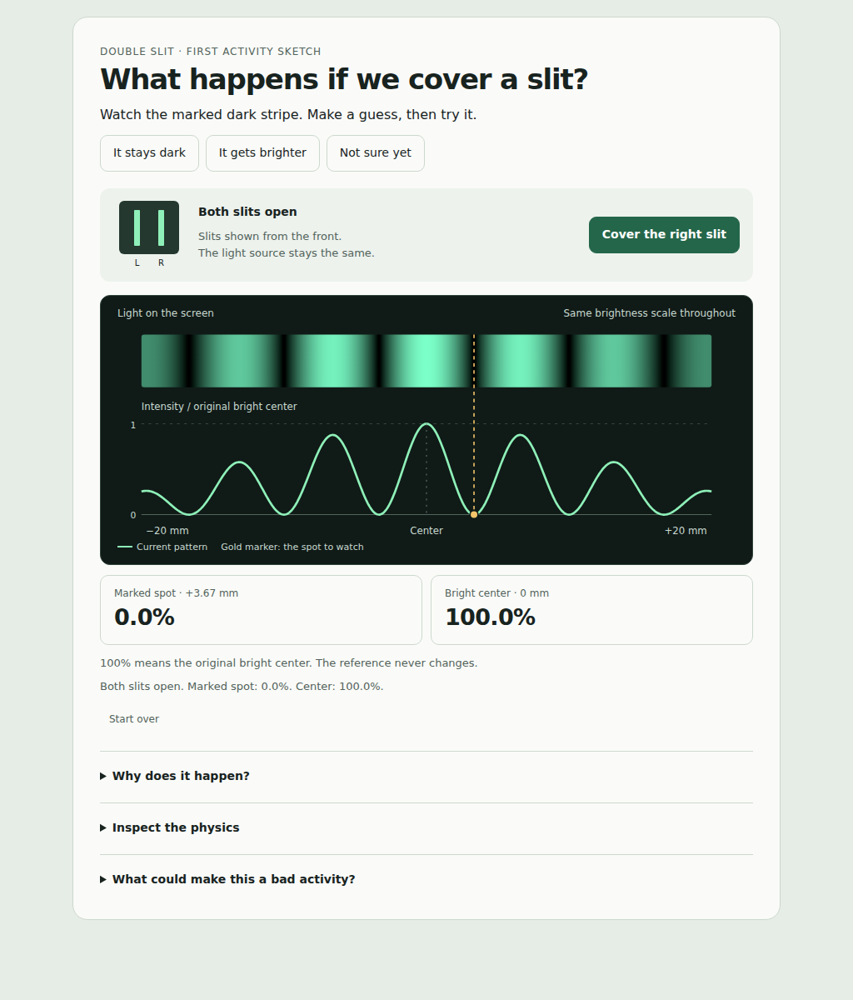
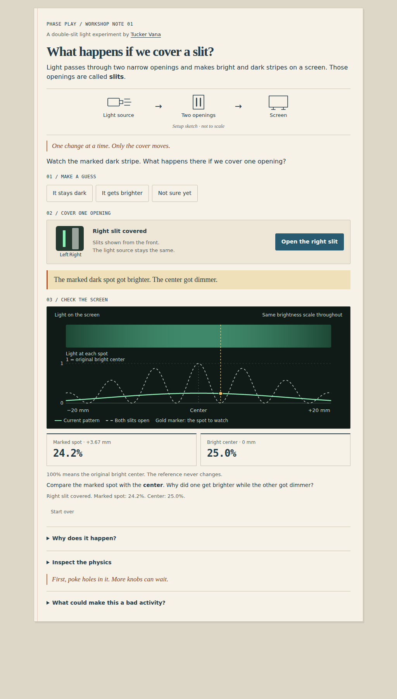

# Phase Play

A small double-slit experiment you can open from disk.

Make a prediction about a dark stripe, cover one slit, and compare what happens
there with what happens at the bright center. Open the explanation to inspect
the model, its assumptions, and a case where the approximation stops working.

## Preview

**Both slits open**

**Right slit covered**

## Run it

Download or clone this repository and open **index.html** in a browser.
The application is one self-contained file. It needs no account, local server,
runtime installation, internet connection, or paid hosting.

## Current stage

This is the first activity sketch. The first milestone is to challenge the
physics and teaching approach before adding more features.

The scalar calculations and simulated control-state checks pass. The browser
check also captured the app and exercised controls in Chrome with network
hostnames blocked. At 320 pixels, plot-axis labels are too small. Physical
keyboard/touch operation, child enjoyment, learning, and an independent human
physics review remain unverified.

See [the evidence log](docs/EVIDENCE.md) for what was observed and what each
check establishes. [The review](docs/REVIEW.md) records the failure cases and
next checks.

## Check or edit it

Optional development commands, using Node.js and no third-party dependencies:

    node tools/build.mjs
    node tools/verify.mjs

Edit **src/challenge.html**, then build to update the distributed index.html.
Verification checks that the distributed file contains the exact source.

The checks compare the embedded formula with an independent finite-aperture
integral, reproduce a far-field versus Fresnel comparison, and exercise state
transitions in a DOM fixture. That fixture does not provide browser rendering
or accessibility evidence. [Saved results](docs/verification.json) identify
the source and distributed file by SHA-256.

An optional browser check uses Python's standard library and an installed
Chromium or Google Chrome browser:

    python3 tools/check-browser.py

It opens the unmodified file directly, exercises controls in controlled-width
frames containing the same app HTML, and saves results and screenshots under
docs/browser. It uses a fresh temporary browser profile with network hostnames
blocked. The [saved browser results](docs/browser/results.json) record the
browser version, source hash, control checks, and measured layout. The current
320-pixel case fails the axis-label readability check.

The [PNG capture workflow](.github/workflows/previews.yml) uses Google Chrome
and commits the images and report to docs/browser when the app or checker changes.

## Physics

This is classical scalar wave optics with equal finite-width rectangular
slits, uniform coherent illumination, matched polarization, and a fixed
far-field geometry. Intensity uses the original two-slit bright center as a
constant reference.

The underlying effect is established physics. The activity, explanation,
implementation, and reproducible checks are the work being evaluated here.
See [the model](docs/MODEL.md) for the equations and limits.

*Built with assistance from Codex.*
